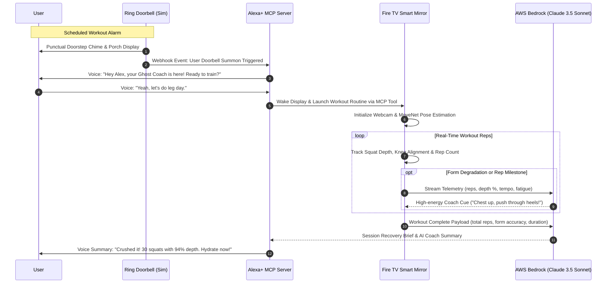

# GhostTrainer Architecture & Cross-Device Flow

GhostTrainer establishes an ambient fitness loop connecting multiple Amazon smart devices into a unified, proactive coaching ecosystem.

## Service Architecture

1. **Ring Doorbell Simulator (`apps/ring-simulator`)**
   - Built on FastAPI.
   - Emulates scheduled doorstep rings, motion triggers, and visual coach presence simulation.
   - Dispatches webhook to Alexa+ MCP; Fire TV consumes via /session/status polling.

2. **Alexa+ MCP Server (`apps/alexa-mcp-server`)**
   - Model Context Protocol (MCP) server running over HTTP with JSON-RPC.
   - Tools exposed:
     - `get_workout_schedule`
     - `start_workout_session`
     - `report_workout_metrics`
     - `get_ai_coach_recovery_brief`

3. **Fire TV Smart Mirror (`apps/fire-tv-app`)**
   - 10-foot UI designed with high contrast Tailwind CSS for living room viewing.
   - D-Pad navigable via standard TV remote keys (`ArrowUp`, `ArrowDown`, `Enter`).
   - MoveNet Pose Estimation running in browser via TensorFlow.js for squat depth & rep tracking.

4. **Bedrock Coach Package (`packages/bedrock-coach`)**
   - Python client integrating with AWS Bedrock (`anthropic.claude-3-5-sonnet`).
   - Analyzes biomechanical telemetry, detects fatigue degradation, and generates real-time audio/visual cues.
